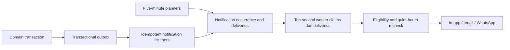

# Notifications: product design and implementation plan

Status: planned, not implemented by this document. This is the target specification for replacing appointment/business notification listeners and templates. Existing authentication and invitation delivery must keep working during the transition. Operational authorization remains in [AGENTS.md](../AGENTS.md); this plan does not authorize migrations, database changes or real messages.

## Local database rollout — 2026-10-10

The authorized `npx prisma migrate dev --name add_billing_notice_renewal_projection` completed successfully against the local `bookify` development database at localhost:5432. It applied `20261009120000_add_professional_notification_recipient`, `20261009150000_add_notification_occurrence_and_expiry` and `20261010120000_add_billing_notice_renewal_projection`; usage reservations and in-app actions were already applied. Prisma reported the database synchronized with the schema, without drift/reset or additional generated migration SQL. `npx prisma generate` then regenerated Prisma Client 7.9.1. Backend non-emitting TypeScript checking now passes, as do 42 suites / 504 mocked tests covering notifications, subscriptions and usage. No seed, reset, server startup or real provider delivery was performed. This supersedes historical local migration/generation blockers below; other environments still need their own rollout and live end-to-end verification remains separate.

## Implemented monthly quota enforcement (October 2026)

The worker now uses `ChannelConfig.billable` for each type/recipient/channel. Missing flags and IN_APP are free. Appointment EMAIL/WHATSAPP deliveries (including fallback-only channels) and CUSTOMER verifications are billable; USER verifications and access invitations are excluded. `fallbackOnly` entries configure fallback billing/retry without creating a second initial delivery.

`NotificationUsageService` reserves capacity before sending, confirms provider acceptance, and releases only known non-delivery. The reservation is unique per delivery and stores its original monthly usage row. EMAIL and WHATSAPP use separate counters; these counters include pending/ambiguous reservations as well as accepted sends. The conditional database update requires a positive limit and count below that limit. Zero entitlement or a missing tenant denies billable sends. Before each billable reservation or current-usage read, `TenantUsageService.ensureCurrentUsage(tenantId, tx, now)` reads the persisted effective subscription and lazily creates the 1-based UTC monthly record. The timestamp is captured after the entitlements lock; entitlement and period use that same timestamp. Existing rows update only email/WhatsApp limits, preserving counters, costs, appointment fields, reset timestamps and historical limits.

Subscription writes and quota synchronization share a transaction under the existing billing advisory lock. Reservations and releases take that lock before row locks, serializing against subscription changes; the conditional usage-row update also protects the last slot. Retrying a reserved delivery reuses its original period and must still have positive current entitlement. A lower positive limit does not invalidate reserved capacity, even when current consumption exceeds the limit. A released reservation must acquire fresh capacity. Release decrements the original row once, even after rollover. Once any attempt is ambiguous, a later rejection cannot return that capacity.

The processor atomically claims the due PENDING delivery for the expected retry count before doing work. Concurrent workers and stale attempt snapshots cannot both send. Retry scheduling clears the claim and increments the attempt atomically. An accepted send is never retried because confirmation, SENT persistence or success logging failed. Claims do not expire: interrupted workers or persistence failures leave an observable `claimed_at` requiring manual reconciliation with provider evidence. Automatic lease recovery is not implemented. A five-minute reconciliation cron now confirms stale email claims only when their stored Resend ID has positive provider evidence; other cases require the standalone manual command described below. Queued email requests use the stable delivery ID as a Resend idempotency key. Ambiguous provider outcomes retain their claim and quota reservation, log RECONCILIATION_REQUIRED, and stop without automatic retry or fallback. Manual reconciliation requires provider evidence; the automatic job never releases quota or retries uncertain sends.

Resend explicit client rejection (except timeout status 408 and concurrent-request status 409) and destination resolution failures are known non-delivery. Transport exceptions, server errors and missing acceptance evidence are ambiguous. Gateways have no tenant quota dependency. The unused `sendDirectlyEmail` helper has no callers and is outside the queued tenant delivery contract.

Notification allowances follow the effective subscription: Pro+ (including its active trial) grants 1,200 emails/500 WhatsApp per UTC month; Pro grants 400/200. Free, expired, suspended, paused, past-due, missing/deleted subscriptions and unknown plans grant zero. Paid cancellations keep capacity until `endsAt`; confirmed downgrades keep the current allowance until `planChangesAt`. Pending upgrades alone grant nothing extra. Confirmation, recovery and effective downgrades replace limits without resetting consumption. Billing renewals and cycle switches do not reset consumption. New UTC months start at zero; there is no proration or unused-capacity rollover and no monthly cron. Current access projects elapsed deadlines even if settlement is delayed.

Quota counters measure consumed capacity (including pending and ambiguous reservations), not successful delivery totals. Success logs/delivery status serve that separate purpose. Zero-limit percentages are zero; positive-limit percentages can exceed 100% after a downgrade. Excluded account/security notifications bypass this policy. Appointment statistics, cost tracking and broader feature access are separate.

Schema/migration: `20261008120000_add_notification_usage_reservations` adds `claimed_at` and the reservation table, foreign keys and state/channel checks. Apply it and regenerate Prisma before rollout; preparing the SQL does not apply it. No backfill is needed because existing counters remain authoritative and only new attempts reserve. Legacy notification limits are replaced from the effective catalog on current access, never interpreted as unlimited. No additional synchronization migration or consumption backfill is required.

Dashboard notification and billing response shapes are unchanged; counts now include reservations. Public web does not consume worker/quota APIs. Neither consumer requires a code change. Unit tests cover policy, UTC boundaries, SQL predicates, reservation transitions, claim losers and gateway outcomes. PostgreSQL concurrency and the migration still require validation against an authorized database; mocked unit tests do not establish database locking behavior.

## Purpose and agreed scope

Customers should know when their appointment is booked or changed and receive useful reminders. Professionals should know about customer actions and their day's agenda/results. Owners should receive business, team and billing notices with a clear next action.

The agreed cadence is a delivery worker every **10 seconds**, a professional-summary planner every **5 minutes**, and a billing-notice planner every **5 minutes**. Running a job does not mean sending everyone a message. Each occurrence has a persisted identity and delivery time.

The catalog, channels and cadence below reflect the conversation. Exact retry limits, expiry windows, reminder spacing, styling and action-route contracts are proposed implementation defaults defined here so the work is testable. They can change through an explicit revision to this guide.

Not included: marketing, review requests, payment-failure notices, appointment-payment receipts, reassignment alerts as a standalone feature, push notifications, or a product rename. Existing security/verification and team invitation emails remain separate supported flows.

## Current evidence and gaps

Existing notification listeners/templates are not the specification. Relevant constraints come from these domain boundaries:

| Evidence | Consequence for the implementation |
| --- | --- |
| [Appointment lifecycle](appointment-lifecycle-and-stats.md), [appointment service](../src/modules/appointments/appointments.service.ts), [public service](../src/modules/appointments/appointments-public.service.ts) | New appointments are CONFIRMED. Mutations commit before asynchronous events; those events alone are not durable. Completion/no-show ends reminder eligibility. Dashboard creation can record past appointments. |
| [Scheduling](scheduling-and-booking.md), [availability module](../src/modules/availability) | Use business-local dates, effective professional hours and exceptions. Share the schedule calculation rather than inventing a second interpretation for summaries. |
| [Professional and invitation lifecycle](professional-creation.md) | A bookable professional need not have a user account. Invitation acceptance happens through explicit acceptance, signup and Google flows. Disabled access differs from a never-linked professional. |
| [Subscription mapper](../src/modules/subscriptions/mappers/provider-subscription.mapper.ts), [subscription guide](subscriptions.md) | `currentPeriodEnd` can come from provider `renews_at` **or** `ends_at`; a period end is not proof of automatic renewal. Free, cancellations, pending changes and uncertain provider operations need explicit handling. |
| [Schema](../prisma/schema.prisma) | Notification/delivery/in-app records exist. Delivery scheduling is named `runAt`. There is no occurrence uniqueness, outbox, claim lease or PROCESSING state in these models yet. |
| [Scheduler](../src/modules/notifications/schedulers/notification-scheduler.service.ts), [delivery repository](../src/modules/notifications/infraestructure/repositories/notification-delivery.repository.ts) | The worker runs every ten seconds and now atomically claims deliveries across processes; claims deliberately have no automatic expiry. |
| [WhatsApp gateway](../src/modules/notifications/infraestructure/gateways/whatsapp.gateway.ts) | It logs the destination and WhatsApp template payload, then reports simulation. The worker does not reserve WhatsApp quota, records FAILED with a SIMULATED reason, and does not retry or create email fallback for simulation. It is not a real delivery channel. |
| [Dashboard routes](../../frontend/app/routes.ts), [notification item](../../frontend/app/features/notifications/components/NotificationItem.tsx) | Calendar/settings/billing routes exist. The current notification action is hardcoded to “Empezar Onboarding” and does not navigate; resource deep links need implementation. |
| [Public pages](../../web/src/pages), [booking APIs](../../web/src/features/booking/api) | Public booking mutations are placeholders and customer management pages are absent. Customer action buttons below require these pages and API integration before release. |

Earlier architecture/index notes that notification documentation was a future task are superseded by this plan. This document does not claim that the target behavior is already implemented.

## Notification catalog

Each row is one notification type per recipient and occurrence. “WhatsApp → email” is a fallback chain, not two simultaneous messages. In-app + email are independent deliveries of the same notification.

| ID / type | Trigger and recipient | Channels | Timing | Primary action |
| --- | --- | --- | --- | --- |
| N01 `tenant.created` | First successful onboarding completion → owner | In-app + email | Both channels immediately after completion | Email: Ir a mi negocio; in-app: none |
| N02 `member.joined` | First committed invitation acceptance → active owner/admins, excluding joining member | In-app | Immediately | Ver equipo |
| N03 `appointment.staff.created` | Customer creates appointment → assigned professional | In-app + email | Immediately | Ver cita |
| N04 `appointment.staff.rescheduled` | Customer reschedules → assigned professional | In-app + email | Immediately | Ver cambio |
| N05 `appointment.staff.cancelled` | Customer cancels → assigned professional | In-app + email | Immediately | Ver cita cancelada |
| N06 `appointment.customer.created` | Staff or customer creates appointment → linked customer | WhatsApp → email | Immediately | Ver mi cita |
| N07 `appointment.customer.rescheduled` | Staff reschedules → linked customer | WhatsApp → email | Immediately | Ver mi cita |
| N08 `appointment.customer.cancelled` | Staff cancels → linked customer | WhatsApp → email | Immediately | Reservar otra cita |
| N09 `appointment.customer.reminder.24h` | Eligible upcoming appointment → linked customer | WhatsApp → email | 24 elapsed hours before, adjusted below | Ver mi cita |
| N10 `appointment.customer.reminder.2h` | Eligible upcoming appointment → linked customer | WhatsApp → email | 2 elapsed hours before, adjusted below | Ver mi cita |
| N11 `professional.day.start` | Professional workday → professional | In-app + email | 1h before first working interval | Ver mi agenda |
| N12 `professional.day.end` | Professional workday → professional | In-app + email | 1h after last working interval | Ver resumen del día |
| N13 `billing.trial.ends.7d` | Current trial → owner | In-app + email | 09:00 local, 7 calendar days before trial-end date | Ver planes |
| N14 `billing.trial.ends.3d` | Current trial → owner | In-app + email | 09:00 local, 3 calendar days before trial-end date | Ver planes |
| N15 `billing.renewal.3d` | Confirmed upcoming automatic renewal → owner | In-app + email | 09:00 local, 3 calendar days before renewal date | Ver facturación |

Customer-created bookings receive N06 as an acknowledgment, in addition to N03 for the professional. Customer self-rescheduling/cancellation receives confirmation on its result page; duplicate customer change messages are outside this release. A future explicit channel preference can add them without changing staff routing.

## Shared delivery and recipient rules

- Tenant ID is mandatory for this catalog. Resolve recipients from tenant-owned records, never from a client-provided delivery address or user ID alone.
- A customerless appointment can notify its professional but cannot generate customer notifications/reminders. Missing customer contact records produce an observable `NO_DELIVERABLE_CHANNEL` skip, not a fabricated success.
- Resolve professional email from the professional's business contact, never the linked user's account email. For the implemented appointment routing slice, email is independent of user linking/membership; in-app requires a linked user with active tenant membership. Missing professional email skips email permanently. Earlier wording suppressed all professional messages when membership was disabled; the agreed routing behavior supersedes that wording for appointment notices. Broader summary/resource-permission policy remains future work.
- Booking `isActive=false` is not access revocation: existing appointments still need operational notices. Soft-deleted professionals receive no new notices. No owner-wide forwarding is enabled by default; record an unrouteable operational notice for support visibility.
- Business/member/billing emails use the current account email; billing always resolves the current active OWNER. Recheck role/membership before delivery, including a delayed email.
- In-app storage, list/unread/read/read-all operations and live updates must be scoped to both recipient and tenant. Session/membership checks apply to sockets too; a user-room name is not authorization. Permission loss must prevent access to old sensitive notification content.
- The actor does not receive a staff-facing notification about their own dashboard action. Customer booking acknowledgment is the intentional exception. Identity is explicit in the event, not inferred from the recipient.
- Future external routine messages respect channel preferences. Essential booking-change messages remain transactional; no promotional content is bundled into them.
- Changing contact details invalidates an unsent resolved address; resolve again just before delivery. Logs contain internal IDs, type, channel and failure codes, not management tokens or full message/contact payloads.

### Timezone and quiet hours

Use `TenantSettings.timeZone` as an IANA zone. Persist UTC instants for execution and retain the intended business date/zone for audit. If settings are missing, use the existing domain fallback `America/Montevideo` and record that fallback; invalid nonempty zones fail scheduling visibly rather than silently using server time.

Default routine external delivery window: **08:00 inclusive to 21:00 exclusive** in the business timezone. The policy should support a future business setting; introducing its storage/form is implementation work. Initially use this documented default. A configurable billing send time must be clamped to the allowed window.

| Category | Quiet-hours policy |
| --- | --- |
| Appointment created/rescheduled/cancelled | Immediate, including at night: this confirms or communicates a direct action. |
| Welcome | In-app and email immediately after setup, at any hour. |
| Member joined | In-app immediate. |
| Appointment reminders | Adjust before the appointment using the algorithm below; never roll forward past its start. |
| Professional summaries | Apply the start/end rules below to both channels so the same summary appears together. |
| Billing notices | Create for 09:00 local; both channels honor that schedule. |

Apply policy at planning **and** at delivery/retry/fallback. If a server wakes at 03:00, a routine item overdue since yesterday is not automatically safe to send. In-app has no audible alert or email side effect; event notices may be inserted any time. Routine scheduled notices retain their chosen schedule.

Local calendar arithmetic is required for billing dates and day summaries; do not subtract `days * 24h`. Appointment reminder offsets are elapsed hours from the appointment instant. For ambiguous local wall times use the earlier valid instant; for nonexistent local times use the next valid instant, then apply eligibility/expiry again. Use one tested timezone helper across planners. Tenant timezone changes replan unsent occurrences; sent occurrences are not replayed.

## Message and button design

Product copy is Spanish, following the current app. Keep product naming aligned with the existing configured brand; this task does not choose between Bookify/Turnify. Dates use explicit weekday/date/time in the business timezone. Include a timezone label in email/WhatsApp; avoid ambiguous “mañana” without a date. Format money with its currency code, including subscription currency separately from service currency.

### Email

Use one responsive layout, approximately 600px maximum width: business/brand header, small category label, clear heading, one-sentence explanation, details card, primary button, optional secondary links, business contact and footer. A readable plain-text alternative must contain the same facts and action URLs.

- Reuse the app's existing brand color for the primary button; neutral background, dark text and a subtle border for details. Cancellation uses a restrained red status label, reschedule amber, confirmation green, and summaries/billing the brand accent. Text and icons carry meaning independently of color.
- Body text at least 16px; comfortable line height; buttons at least 44px high. Stack details/actions on narrow screens. Keep content readable with images disabled and in dark-mode email clients.
- Use one primary CTA, at most two secondary text links. “Cancelar cita” is a secondary text action leading to a confirmation page. Opening an email link must never cancel, reschedule, join a team or change billing.
- Reschedule shows “Antes” and “Ahora” date/time rows; cancellation shows the cancelled date clearly; reminders emphasize the upcoming date/time/location. Do not include internal notes or management tokens as visible text.
- Preview text adds context instead of repeating the subject. Escape user-entered names/reasons and use meaningful link labels. Render long business/service names and missing optional fields deliberately.

Example appointment email:

```text
[Business name]                         CITA CONFIRMADA
Tu cita está confirmada
Hola Ana, te esperamos en {businessName}.

Servicio       {serviceName}
Profesional    {professionalName}
Fecha          {weekday}, {date}
Hora           {time} · {timeZoneLabel}
Dirección      {location}

[ Ver mi cita ]
Reagendar · Cancelar cita
¿Necesitás ayuda? {businessContact}
```

### In-app

Each item has a category icon, concise title, one/two-line summary, relative creation time, static unread dot and an explicit action label. No pulsing unread indicator. The whole row and CTA navigate to the same destination and mark read once; marking read alone never changes the resource. Keep read items actionable.

Support keyboard focus, accessible link/button labels, loading/error/empty states, mobile presentation and “Marcar todo como leído” for the selected tenant. Add a generic icon for unknown versioned types. The API must provide the correct action label and typed resource context; remove the hardcoded onboarding label. Do not include public management tokens in staff notifications.

### WhatsApp

Use short transactional copy: business, reason, service, professional, explicit date/time/timezone, location where useful, and one “Ver mi cita” URL. Cancellation uses “Reservar otra cita”. Keep richer choices on the management page. Provider-specific template formats, approvals, channel consent/eligibility and button limits must be verified when integrating the selected provider; this document makes no claim that the current gateway supports them.

### Action destinations and permissions

These are target route contracts. Existing base routes are not evidence that their deep-link behavior exists.

| Action | Target contract and required behavior |
| --- | --- |
| Ir a mi negocio | Dashboard `/:slug`; requires active membership. |
| Ver equipo | Dashboard `/:slug/settings?section=team`; implement/verify section selection and TEAM_READ. |
| Ver cita / Ver cambio / Ver cita cancelada | Dashboard `/:slug/calendar?date=YYYY-MM-DD&appointmentId=:id`; implement fresh authorized drawer lookup, including cancelled appointments. Never rely only on visible calendar rows. |
| Ver mi agenda | Dashboard `/:slug/calendar?date=YYYY-MM-DD&professionalId=:id`; constrain STAFF to their own professional. |
| Ver resumen del día | Same calendar route for the original date with `summary=day`; implement an authorized own-professional day-summary view. Do not route STAFF to owner/admin-only Reports. |
| Ver planes | Dashboard `/:slug/billing/plans`; OWNER only. |
| Ver facturación | Dashboard `/:slug/billing`; OWNER only; portal management obtains a fresh URL on click through the existing billing API. Never persist expiring provider portal URLs in notifications. |
| Ver mi cita / Ver detalles | Proposed public web `/b/:slug/appointments/:token`; token-scoped details and currently allowed actions. Page and integration must be built. |
| Reagendar / Cancelar cita | Proposed public management page with `?action=reschedule` / `?action=cancel`; show the corresponding flow, require explicit mutation, and recheck status/window/token server-side. |
| Reservar otra cita | Public `/b/:slug/book`; preselection is optional and must not submit a booking. Creation API integration is a release dependency. |

Build absolute external URLs from trusted dashboard/public-web configuration, never the incoming request host or arbitrary payload URLs. In-app may use validated internal paths. Encode parameters and preserve a safe internal return destination across login/tenant selection. Wrong tenant, revoked access, expired/unavailable token or missing resource produces a useful unavailable page without leaking details. Staff without dashboard access receive the email facts and business contact, without a dead CTA.

### Dashboard API contracts to implement

Keep the current `/notifications`, `/notifications/read-all` and `/notifications/:id/read` routes, adding tenant predicates to recipient predicates in every read/write. In-app appointment notifications now persist an `actionLabel` plus versioned `{ version: 1, kind: 'APPOINTMENT', appointmentId }` action data; the dashboard builds a tenant-scoped calendar deep link from that typed resource and opens the fresh, authorized appointment drawer. Existing `actionUrl` remains as a fallback for older/untyped records. Cursor pagination for history is implemented with a stable creation-time/ID order and a selected-tenant unread count on every page. Query keys include account and tenant; tenant changes clear previous notification results and subscriptions.

Proposed day-summary read: `GET /professionals/:id/day-summary?date=YYYY-MM-DD`. Require active membership plus own/others appointment-read permission, with STAFF restricted to their linked professional. Return professional ID, business date/timezone/currency, generatedAt, scheduled/completed/cancelled/no-show/unresolved counts, completed service value as a Decimal string, and nullable first upcoming appointment time. The backend calculation is shared with N11/N12. This is a proposed endpoint, not an existing route; the dashboard summary action depends on it. It exposes no other professional's data and no customer payment/commission claim.

## Per-notification implementation rules and copy

### N01 — Business welcome

- Produce `tenant.created` once, in the transaction that first completes onboarding. Draft tenant creation and retries do not produce a welcome.
- Listener: `TenantCreatedListener`; create one owner occurrence keyed by tenant + onboarding completion identity + recipient. In-app and email immediately eligible, with no quiet-hours restriction. Expire unsent welcome email after seven days.
- Email subject/title: **“¡Bienvenido a Bookify!”**. Body: “Tu negocio ya está listo. Entrá y empezá a organizar tu agenda y gestionar tus citas desde un solo lugar.” CTA: **Ir a mi negocio**. In-app title: **“¡Bienvenido a Bookify!”**. Body: “Qué bueno tenerte acá. Todo listo para empezar a gestionar tu agenda y tus citas.” No in-app CTA. Do not claim that incomplete public booking functionality is live.
- Required payload: tenant identity/name/slug, owner identity, completion instant, locale, timezone. Acceptance: replayed confirmation yields one welcome; rolled-back confirmation yields none.

### N02 — Member joined

- Produce `invitation.accepted` only when an invitation is first consumed and membership/linking commits. Cover explicit accept, invited signup and Google acceptance. Issuing/resending an invitation, restoring access and repeating acceptance do not count as joining.
- Listener: `InvitationAcceptedListener`; notify each current active owner/admin except the joining member, with one occurrence per accepted invitation + recipient. Recheck recipient TEAM_READ on display/delivery.
- Title: **“{memberName} se unió al equipo”**. Body: “Ya tiene acceso a {businessName} como {roleLabel}.” CTA: **Ver equipo**. Required payload: invitation/membership/user/tenant IDs, display name, accepted role and acceptedAt. No token.
- Expire uncreated/undelivered notices after 24h; retained in-app history remains readable while authorized. Acceptance: all three acceptance paths behave identically and one accepted invitation cannot generate multiple notices per recipient.

### N03–N05 — Customer actions sent to the professional

`AppointmentNotificationListener` routes durable created/rescheduled/cancelled events by explicit actor kind. Resolve the assigned professional, with channel eligibility from the shared rules. Customer cancellation still creates a notice when there are no remaining active appointments that day.

| ID | Subject / title | Message details | Button |
| --- | --- | --- | --- |
| N03 | “Nueva cita con {customerName}” | “{customerName} reservó {serviceName} para el {date} a las {time}.” Include duration and customer contact in email only as needed for appointment work. | Ver cita |
| N04 | “{customerName} reagendó su cita” | Explicit previous and new date/time; service and professional. Shared reschedule reason only if supplied. | Ver cambio |
| N05 | “{customerName} canceló su cita” | Cancelled service/date/time, cancellation actor and shared reason if present. | Ver cita cancelada |

Creation and rescheduling email expire at the earlier of appointment start or 24h after the event. Cancellation email expires after 24h. In-app event history may still be created within the 24h event catch-up window, even if the appointment already started; its text describes a historical action and links to current state. Suppress unsent external created/rescheduled messages superseded by a newer schedule revision or cancellation. Retain already-delivered history, showing the current appointment on click.

Key: tenant + event ID + type + professional recipient. A reschedule is a new event, not the same occurrence as appointment creation. Required payload includes old/new schedule, service/customer/professional identifiers and display snapshots, actor, domain revision and event timestamp. Verify customer-actor notices cannot fan out to unrelated staff.

### N06–N08 — Appointment messages sent to the customer

Listener: the same `AppointmentNotificationListener`, with customer routing separated from staff routing. N06 handles both creator kinds. N07/N08 handle staff actions. Suppress historical dashboard-created appointments and historical reschedules from customer external delivery; they are record keeping, not future booking messages.

| ID | Subject / heading | Message details | Primary / secondary actions |
| --- | --- | --- | --- |
| N06 | “Tu cita en {businessName} está confirmada” | Service, professional, explicit date/time, duration and location. Use appointment price/discount snapshots if displaying a total. | Ver mi cita / Reagendar / Cancelar cita |
| N07 | “Cambió el horario de tu cita” | “{businessName} reagendó tu cita.” Show Antes/Ahora and shared reason; no ambiguity about the new time. | Ver mi cita / Reagendar / Cancelar cita |
| N08 | “Tu cita en {businessName} fue cancelada” | Cancelled date/time/service and shared reason. “Podés elegir otro horario disponible.” Never promise a refund. | Reservar otra cita / Ver detalles |

Required payload: tenant/customer/appointment IDs, event ID/revision, actor, schedule snapshots, service/professional/location and optional public reason. Resolve capability links safely for this customer message; exclude internal appointment notes. Cancelled appointment details remain readable but mutation actions are absent. New-booking CTA is shown only when public booking is available.

Keys use event + type + recipient. Created/rescheduled deliveries expire at appointment start or after 24h, whichever comes first. Cancellation expires after 24h. Apply the same supersession rules as staff notices. Acceptance includes customer-created acknowledgment, staff action routing, customerless bookings, past bookings, missing channels and safe management links.

### N09–N10 — Customer reminders

`AppointmentReminderListener` plans two independent occurrences at creation/rescheduling; it cancels all unsent reminder channels and fallback attempts on reschedule, cancellation, completion or no-show. Only future PENDING/CONFIRMED appointments with a customer are eligible. Existing PENDING copy says “Recordatorio de tu cita”, not “confirmada”.

Required identity: tenant + appointment + schedule revision + reminder offset + customer. On reschedule, never revive an old cancelled occurrence. A revision must change only for schedule-relevant changes, not unrelated metadata edits.

Planning algorithm, with proposed defaults:

1. Calculate nominal `startsAt - 24h` and `startsAt - 2h`. If nominal time has already elapsed when booking/rescheduling, skip that offset; a booking confirmation already supplies immediate context.
2. If nominal time is inside allowed hours, keep it. Otherwise choose the next allowed opening **only if** it leaves at least 30 minutes before the appointment. If not, use the preceding allowed day's closing time minus one hour (20:00 with default hours).
3. Do not create a reminder in the past, within 30 minutes of the booking/change acknowledgment's planned send time, or less than 30 minutes before appointment start. Skip it instead. Repeat the spacing check against actual confirmation/change delivery at send time.
4. If adjusted reminders are less than 60 minutes apart, retain one: prefer the 2h occurrence. Check already-sent reminders too, including across a reschedule, to avoid another reminder within 60 minutes. Do not replace the immediate change message with a reminder.
5. Before each send, confirm appointment status, schedule revision, recipient and token/action eligibility. A reminder delayed by an outage or retry may send only within two hours of its adjusted due time, still inside allowed hours and at least 30 minutes before the appointment; otherwise skip it.

Examples, assuming booking sufficiently early:

| Appointment | Nominal 2h reminder | Result with 08:00–21:00 hours |
| --- | --- | --- |
| 09:00 | 07:00 | 08:00 on appointment day |
| 07:00 | 05:00 | 20:00 previous day |
| 08:15 | 06:15 | 20:00 previous day; 08:00 leaves less than 30 minutes |
| 14:00, booked at 13:00 | 12:00, already elapsed | No 2h reminder; send booking acknowledgment |

N09 subject: **“Recordatorio: tu cita en {businessName}”**. N10 subject: **“Tu próxima cita en {businessName}”**. Body: “Te esperamos el {date} a las {time} para {serviceName} con {professionalName}.” Do not say “en dos horas” or “mañana” after an adjusted schedule. Primary **Ver mi cita**; email secondary **Reagendar** and **Cancelar cita** only if those actions remain allowed. Include location/contact. Required data is the current appointment view, not stale creation-time text.

### N11 — Professional morning summary

Planner: `ProfessionalSummaryPlanner` in Appointments, every five minutes. Resolve the professional's effective working intervals for the business date using availability's rules, including business/professional hours and exception precedence. “Start” is the earliest effective interval, not the first appointment. Split shifts produce one morning summary.

- Nominal due = workday start minus one elapsed hour. Advance a quiet-hours due time to the next allowed opening. Send only while still before the first future PENDING/CONFIRMED appointment. Skip days with no such appointments. If no effective working interval exists, skip and record the scheduling inconsistency; do not invent a shift from appointment times.
- Count that professional's remaining PENDING/CONFIRMED appointments whose starts belong to the target business date. Include customerless appointments; exclude cancelled/completed/no-show. Recompute the count and earliest start at dispatch so delayed messages remain accurate.
- Subject/title: **“Tu agenda de hoy: {count} citas”** (correct singular). Body: “Hoy tenés {count} citas programadas. La primera es a las {firstTime}.” Include date and working-day range. Primary **Ver mi agenda**. Do not email a full customer list by default.
- Key: tenant + professional + local date + `day.start` + recipient. Deadline: earlier of first appointment start or two hours after adjusted due time. If no appointment was eligible when first checked, it can become eligible during this window; after the window, individual booking notices cover new activity.
- Acceptance: a 09:15 start yields 08:15 due; no duplicate across cron runs; early 07:00 appointment does not receive a useless morning summary at 08:00; closed days and split shifts are handled.

### N12 — Professional evening summary

Same planner, nominal due = last effective working interval end plus one elapsed hour. One summary per professional and original business date. If due falls outside allowed hours, defer to next opening, preserving the original date. Recheck the schedule before sending. If any appointment on that date still has a future end time, defer until one hour after the latest such end, then apply quiet hours; do not announce final results during ongoing work.

- Include appointments with start in `[local midnight, next local midnight)`. Use actual timezone boundaries, not a fixed 24h window. If the date has no appointments of any status, skip.
- Count COMPLETED, CANCELLED, NO_SHOW and still PENDING/CONFIRMED separately. Include customerless appointments. Sum `price - discountAmount` for COMPLETED only using Decimal arithmetic and tenant currency, consistent with [lifecycle metrics](appointment-lifecycle-and-stats.md).
- Subject/title: **“Tu resumen del {date}”**. Body: “Completaste {completedCount} citas. Valor de servicios completados: {amount} {currency}.” Show cancellations/no-shows and “{unresolvedCount} citas pendientes de registrar” when nonzero. Never call this cash collected, profit or commission.
- If dispatched the next morning, use “Resumen de ayer” only when the date really is yesterday; always retain the explicit date. Primary **Ver resumen del día**. Email contains summary totals, not unnecessary customer details. Unlinked professionals have no dashboard CTA.
- Freeze the summary snapshot when the first channel dispatches so in-app/email agree. Late status corrections appear on the live day view; they do not resend the summary. Show “Datos al {snapshotTime}”. Expire at the next local noon after the target date to avoid old daily reports after a prolonged outage.
- Key: tenant + professional + local date + `day.end` + recipient. Acceptance covers discounts, zero completions, unresolved statuses, late appointments, timezone boundaries, deferred “ayer” copy and corrections after dispatch.

### N13–N14 — Trial-ending notices

Planner: `BillingNoticePlanner` in Subscriptions, every five minutes. Resolve the current active owner and current non-deleted TRIAL subscription with a future `trialEndsAt`. An active Free/paid plan with retained trial history is not a trial.

- For offsets 7 and 3, subtract local calendar days from the trial-end date, choose 09:00 and convert to UTC. Create on that local due date once the due time has passed. Catch-up is allowed only through 21:00 of that same date; no later replay or sending both milestones together after a multi-day outage.
- Key: tenant + subscription + exact trial-end instant + offset + owner. Trial-date changes cancel unsent old notices. Upgrading/choosing Free/ending the trial invalidates queued trial notices, including email after in-app has been delivered.
- N13 subject/title: **“Tu prueba termina el {endDate}”**. Body: “Tu período de prueba termina el {endDate} a las {endTime}. Revisá los planes disponibles para {businessName}.”
- N14 subject/title: **“Tu prueba está por terminar”**. Body uses the same explicit end date/time and a clear **Ver planes** CTA. Secondary **Ver facturación**. No promise of automatic charges or loss of access until those billing policies are established.
- Required data: tenant/owner/subscription IDs, current trial state/end instant, currency only if actual plan amounts are shown, locale/timezone. Acceptance: midnight/DST dates, owner-only access, early conversions, changed deadlines and repeated runs.

### N15 — Upcoming renewal

Same billing planner, 09:00 business-local three calendar days before the authoritative next automatic renewal. Same-date catch-up only until 21:00. Key: tenant + subscription + exact renewal instant + offset + owner.

- Require confirmed automatic renewal of a paid subscription. Exclude Free, trials, cancelled/expiring, paused/past-due/suspended subscriptions, pending Free transitions and unresolved cancellation/resumption/plan-change intents. Check provider-synchronized state again before delivery.
- Persist an explicit `nextRenewalAt`/auto-renew eligibility projection (or an equally unambiguous domain value) from verified subscription synchronization. Do not treat `currentPeriodEnd` or `endsAt` alone as renewal eligibility. Planners read this projection; they do not call the provider for every tenant every five minutes. Proposed freshness limit: 24h since a successful authoritative synchronization. A due candidate with older/unknown state requests deduplicated, bounded reconciliation through the subscription service outside database transactions; the planner retries after reconciliation within the same-date delivery window. Provider failure keeps the notice unsent and observable. A quiet subscription cannot rely on webhooks alone to satisfy this freshness rule.
- Confirmed scheduled paid plan/cycle changes may renew into different terms. Display the next effective plan/cycle when established; if uncertain, omit those details or suppress the notice pending reconciliation. Never quote `Subscription.amount` as a guaranteed next invoice total: taxes, discounts and changes can differ. An amount is optional and explicitly estimated unless authoritative next-invoice data exists.
- Subject/title: **“Tu suscripción se renueva el {renewalDate}”**. Body: “La renovación de {planName}, {cycleLabel}, está prevista para el {renewalDate}. Podés revisar los detalles en Facturación.” Primary **Ver facturación**. No cancel button that performs a provider mutation from an email.
- Cancellation, changed renewal date, Free transition or superseding provider version cancels unsent occurrences. Already-sent in-app history remains history; the CTA reads current billing state. Acceptance includes cancelled subscription with a populated period end, pending Free, annual renewal, changed dates and duplicate/out-of-order webhooks.

## Required listeners, domain events and cron jobs

### Durable event flow



Write an outbox row in the same transaction as the successful business change, using the caller's transaction client. Publish/consume only committed rows. In-process event emission may wake the worker, but correctness must not depend on it. Repeated commands that do not change domain state produce no new event.

Common event envelope: `eventId`, versioned type, `occurredAt`, `tenantId`, aggregate ID, monotonic domain/schedule revision, actor kind (`CUSTOMER`, `STAFF`, `SYSTEM`), actor ID where applicable, and a typed minimal payload. Preserve old/new schedule and public reasons for change messages; use fresh domain reads for current eligibility. Do not invent an actor for cron-generated occurrences.

| Proposed listener | Events / entry points | Responsibility |
| --- | --- | --- |
| `TenantCreatedListener` | `tenant.created`; onboarding confirmation transaction | N01 only on first completion. |
| `InvitationAcceptedListener` | `invitation.accepted`; shared invitation-consumption transaction used by accept/signup/Google | N02 once per joining event and owner/admin recipient. |
| `AppointmentNotificationListener` | `appointment.created.v1`, `appointment.rescheduled.v1`, `appointment.cancelled.v1`; public and authenticated mutations | N03–N08, actor routing, event snapshots and obsolete-message suppression. |
| `AppointmentReminderListener` | Same appointment events plus `appointment.finished.v1`; all outcome paths | Create/replace N09/N10 and cancel pending work for terminal outcomes. Reopening to a future eligible state must explicitly replan if that lifecycle becomes supported. |
| `ProfessionalSummaryInvalidationListener` | Proposed `professional.schedule.changed.v1`, `tenant.schedule.changed.v1`, `schedule.exception.changed.v1`, `tenant.timezone.changed.v1`, professional/access changes | Recalculate unsent summary due times; cancel ineligible recipients. Five-minute reconciliation also repairs missed invalidations. |
| `BillingNoticeInvalidationListener` | Proposed `subscription.synchronized.v1`, `subscription.plan-intent.changed.v1`, owner/access/timezone changes | Cancel obsolete N13–N15 and mark affected subscriptions for replanning. Emit only after committed billing synchronization; retain its stale-version protections. |

Listener classes are proposed responsibilities, not a mandate for one file per event. Keep schedule policy, recipient resolution, typed payloads, rendering and provider I/O separate. Services should read as business flows; use feature `types/`, `dto/` and `exceptions/` according to backend guidance.

### Cron inventory

Nest's six-field expressions below describe proposed schedules. These ticks run against UTC instants and are independent of any one tenant timezone.

| Job | Expression / interval | Work |
| --- | --- | --- |
| Notification worker | `*/10 * * * * *` / 10 seconds | Drain committed outbox work in bounded batches, then atomically claim due deliveries; render/send/retry. Keep outbox/delivery batch budgets separate so one backlog cannot starve the other. |
| Professional summary planner | `0 */5 * * * *` / 5 minutes | Reconcile current-day morning/evening occurrences and previous-day deferred evenings; scan next local day when a before-start offset crosses midnight. Upsert each eligible occurrence once. |
| Billing notice planner | `0 */5 * * * *` / 5 minutes | Find trial/renewal milestone candidates for local due dates, check eligibility, upsert N13–N15. Check current eligibility before creation; pending occurrences keep their original snapshot until expiry. |

No separate cron is needed for each template or appointment reminder. The appointment listeners persist reminder `runAt` values in advance. Planners query `dueAt <= now` within each type's expiry window, never require equality with the current minute. Target normal delivery is within roughly five minutes plus a worker tick of a planner due time; provider latency/backlog can add delay.

Use bounded, indexed, keyset-paginated candidate queries and durable scan progress per planner cycle. Group timezone/date calculations or use a persisted next-due projection as scale requires; do not scan every tenant's full appointment history each tick. A per-job database lease avoids overlapping planner scans; occurrence uniqueness remains the final duplicate guard. No Redis or separate queue product is required for the first PostgreSQL-backed implementation.

## Persistence, delivery reliability and fallback

These are proposed schema/domain additions, not existing fields:

| Area | Required data / invariant |
| --- | --- |
| Outbox | Unique event ID, tenant/aggregate/revision, versioned payload, occurredAt, availableAt, claim lease, attempts and processedAt; write atomically with domain state. |
| Notification occurrence | Unique `occurrenceKey`, type, tenant, stable recipient identity/kind (including unlinked professional), source event/revision, business date, intendedDueAt, expiresAt, payload/template version and suppression reason. |
| Delivery | Existing `runAt` is the next attempt UTC time; retain original intendedDueAt separately. Channel uniqueness per occurrence, PENDING/PROCESSING/ACCEPTED/DELIVERED/FAILED/CANCELLED/SKIPPED (or equivalent documented states), claim token/lease, attempt count, provider ID and last result code. |
| In-app | One row per occurrence; tenant + user scope, correct title/message/action label and typed resource action. Delivery/read state is independent from email delivery state. |
| Billing projection | Authoritative nextRenewalAt, explicit auto-renew eligibility, synchronized version/time and invalidation on pending provider intents. |

Use atomic INSERT/upsert with a database unique constraint for occurrence creation. App-level “find then create” checks are insufficient. Serialize listener revisions per aggregate or use conditional version checks so a delayed creation event cannot recreate reminders cancelled by a later event. Upsert/cancellation of reminders must be tenant-scoped and include all unsent channels/fallbacks.

Claim due rows atomically with a bounded lease (for example a short transaction using `FOR UPDATE SKIP LOCKED`). Commit the claim before provider I/O. Use claim tokens when completing work so an expired worker cannot overwrite a newer claim. Set provider timeout below lease duration and renew leases for legitimate long work. An in-memory `isProcessing` flag only prevents local overlap.

Logical occurrences and in-app inserts should be duplicate-free. External transport is at-least-once unless provider idempotency/reconciliation closes the send/ack crash gap. Supply a stable delivery ID as provider idempotency key when supported. A timeout after acceptance is **unknown**, not a definite failure: reconcile by provider ID/status before retrying or falling back. Never promise exactly-once external delivery.

### Channel behavior

1. Customer channel selection checks WhatsApp integration availability, permitted recipient/channel eligibility, phone and usage allowance. If unavailable, select email immediately and record why. Until the real gateway exists, no WhatsApp attempt may report success.
2. For temporary, definitely unsuccessful failures, retry after 1, 5 and 15 minutes (maximum three retries), respecting expiry and quiet hours. Honor a longer provider retry-after when it remains useful. Permanent failures skip retries.
3. When WhatsApp definitively fails/exhausts retries, create email fallback once under the same occurrence. Fallback inherits current-state checks, quiet hours, spacing and expiry; it does not get a fresh lifetime. Missing email ends in an observable failure/skip.
4. Accepted provider delivery is not proof the recipient received it. Store acceptance separately from final delivery/failure where callbacks exist. Authenticate/deduplicate callbacks and reject stale transitions. A late success after fallback has already been sent is a recorded duplicate risk, not a reason to send again.
5. In-app + email proceed independently; an email failure must not recreate the in-app item. A successful provider send followed by a usage/log-write failure must not resend the message. Account for delivery/cost with idempotent ledger/projection writes.

Refresh eligibility as close as possible to send. Cancellation can race with an already-started provider request; stop all unclaimed work and document the in-flight boundary instead of promising recall of sent messages.

## Implementation sequence

| Slice | Work and completion criteria |
| --- | --- |
| 1. Policy and persistence foundation | Pure timezone/quiet-hours/expiry/recipient policies; typed catalog; occurrence uniqueness, outbox, claim leases, version handling and delivery status semantics. Prepare reviewed additive schema/migration files; apply/generate only under explicit Prisma authorization. No external sends enabled. |
| 2. Actions and presentation | Shared responsive email, in-app actions/mobile states, public appointment management/booking integration, authorized day-summary/calendar deep links. Fixture previews for every catalog row. No CTA points to an unimplemented page. |
| 3. Appointments | Transactional producers for public/authenticated mutations; N03–N10 routing, snapshots, reminder replacement and stale suppression. Email delivery first; real WhatsApp adapter/fallback behind a capability flag. |
| 4. Business and members | First-onboarding producer and shared acceptance producer; N01/N02 with all acceptance paths and recipient permissions covered. Preserve invitation and verification delivery. |
| 5. Billing | Authoritative renewal projection, synchronization/intent invalidation and five-minute planner; N13–N15 with correct owner/date/plan rules. |
| 6. Professional summaries | Shared effective schedule read, five-minute planner, own-professional aggregate read/view and N11/N12. Verify monetary meaning and deferred-day copy. |
| 7. Rollout and observation | Dry-run candidates, inspect metrics, enable types/channels gradually, verify controlled delivery, document actual implemented guarantees. |

Migration planning must include existing pending deliveries: map/reschedule eligible future reminders into new occurrence identities; cancel superseded legacy pending rows; preserve sent/read history. Choose a cutover instant and ensure exactly one producer owns each type after it. Disable replaced listeners before enabling their successors. Do not backfill welcome/member history or past billing milestones. Reconcile existing future appointments for still-useful reminders at rollout, without creating a burst of immediate sends. Database changes/backfill require task-specific authorization.

Backend owns domain events, queues, policies, recipients, billing/schedule reads and rendering. Dashboard owns notification DTO/types, tenant-scoped queries, read actions/socket handling, action labels and authorized deep links/day view. Public web owns customer action pages and mutation integration. Both consumers have explicit implementation work; neither is assumed unaffected by the future feature. This documentation change alone alters no API.

## Verification and acceptance plan

Use a controllable clock and fake gateways; unit/integration checks must not send mail or activate live schedulers. Test domain behavior through public service boundaries, not listener private helpers.

| Area | Required cases |
| --- | --- |
| Routing/catalog | All N01–N15 recipient/channel rules; self actions; customer-created acknowledgment; customerless/past bookings; missing contacts; unlinked professional versus disabled membership; owner-only billing. |
| Domain durability | Rollback yields no outbox/notification; crash after commit is recoverable; duplicate event does not duplicate occurrence; all invitation acceptance and public/auth appointment paths participate. |
| Time | Business/server zones differ; midnight, year/month boundaries, DST gap/fold; 09:15 shift; 03:00 restart; quiet-hour boundary; early appointments; adjusted reminder spacing; next-morning evening summary; timezone changes. |
| Schedule/summary | Business/professional exceptions, closed day, split shifts, schedule edits after planning, empty day, new/cancelled appointments near dispatch, counts/status corrections, Decimal discounts and no claim of collected money. |
| Billing | Exact 7/3-day dates, conversion to paid/Free, cancellation with period end, renewal-date change, owner change, confirmed/uncertain pending plan/cycle changes, stale webhooks, same-date catch-up and expired milestone skip. |
| Worker | Two processes claim one row; expired claim recovery and stale claimant rejected; no equality-minute dependence; bounded batch fairness; outbox replay and out-of-order aggregate revisions. Use real isolated PostgreSQL concurrency checks under separate authorization before claiming these guarantees. |
| Delivery | 1/5/15 retry, expiry during retry, quiet-hours fallback, missing email, disabled WhatsApp, provider timeout/unknown acceptance, delayed callbacks, send-success/log-failure and per-channel independence. |
| Permissions/actions | Tenant + recipient isolation for HTTP/read-all/socket; revoked access; own-professional day view; safe login return; unavailable resource/token; no mutation from GET; no management tokens in staff/log payloads. |
| Visual/content | Render every email fixture at mobile/desktop widths, long/missing data, pluralization, explicit dates/timezones/currency, dark mode/images disabled/plain text; keyboard/mobile in-app navigation and every CTA destination. |

Observe due-to-send latency, overdue/expired/skipped counts by reason, outbox backlog, claim recovery, retries, unknown provider results, fallback rate and failures per type/channel. Logs should explain why a notification did not send. Alert on sustained backlog or recurring planner/provider failure; a successful cron tick is not proof of successful delivery.

Release gates: provider-specific WhatsApp contract and eligibility verified; public action pages working; explicit billing renewal/freshness projection established; concurrency and timezone cases passing; old/new producer cutover reviewed; no accidental real sends during tests. Until WhatsApp integration is ready, release eligible customer notifications by email and keep WhatsApp unavailable.

When implementation lands, update this document per slice with concrete file links, current guarantees and validation evidence. Keep proposed behavior visibly distinct from shipped behavior.

## Implemented in-app business isolation

Pagination anchors are resolved using both tenant and recipient before applying the `(createdAt, id)` boundary. A cursor belonging to another scope, or a deleted cursor, returns an empty page with `nextCursor: null`. Equal timestamps use descending IDs to keep page order deterministic. Verification on October 9: notifications, tenant usage and subscription unit checks passed (20 suites, 248 tests); the non-emitting backend TypeScript check passed. These checks use fake providers and do not establish PostgreSQL concurrency guarantees.

`GET /notifications`, `PATCH /notifications/:id/read` and `PUT /notifications/read-all` use the guard-selected tenant plus authenticated recipient for all predicates. Listing retains newest-first ordering with configurable page size; unread counts cover the selected scope and updates retain `{ count }` responses. Other business/user IDs update zero rows.

The notification socket requires the access-token cookie and `handshake.auth.tenantId` with active membership at connection time. It joins a tenant/user room and sends only `notifications.changed` with `{ tenantId }`. Membership is not continuously revalidated; HTTP guards remain authoritative for content after revocation.

`GET /notifications` accepts an optional UUID `cursor` and a `limit` from 1 through 50 (default 10). It returns `{ unreadCount, total, notifications, nextCursor }`; `nextCursor` is the last row's ID when another page exists, otherwise null. Rows sort by `createdAt DESC, id DESC`, and cursor predicates remain scoped to the authenticated recipient and selected tenant. The dashboard shares a 24-item cursor query: the dropdown previews five items, while the history page replaces the visible page using Anterior/Siguiente controls when total exceeds 24. It shares `['notifications', tenantId, userId]` queries, forwards cancellation and `expectedTenantId`, disables reads without both IDs, and hides cached content on query errors. NotificationToggle alone owns the socket; business/user changes and logout disconnect it. Connect/reconnect and matching refresh signals invalidate only that scope. Read mutations use the existing HTTP client/PATCH or PUT routes and invalidate the captured scope. Public web has no notification consumer and needs no change. Outbox processing and automatic claim recovery remain unimplemented. Implemented typed actions and delivery policies are described in the later sections.

## Implemented provider idempotency and simulation (October 9, 2026)

Queued emails pass `notification-delivery/<deliveryId>` to Resend. Its [documented retention](https://resend.com/docs/dashboard/emails/idempotency-keys) is 24 hours; this is not permanent deduplication. Unknown acceptance (including transport errors, missing acceptance IDs and HTTP 408/409) keeps the claim and original reservation for manual reconciliation. No retry/fallback is scheduled. Definite rejections retain configured retries and release only unambiguous reservations. Accepted sends still never retry because local persistence fails. Manual recovery is exposed through the standalone internal command below, without an HTTP API. The automatic job confirms only known Resend IDs; neither path blindly clears claims or releases quota without provider evidence.

WhatsApp is intentionally a console simulation. Its payload output may contain customer data or management links; keep simulation logs local and do not forward them to shared production logging. Simulation records a FAILED delivery with an explicit SIMULATED reason, consumes no quota, and triggers no fallback. When replacing this adapter with a real provider, remove the worker's explicit WhatsApp quota bypass and implement provider acceptance/idempotency before enabling it. Dashboard/public-web response contracts are unchanged. No database changes are required by this slice.

## Implemented appointment presentation (October 2026)

Creation, reschedule, cancellation and 24h/2h reminder templates now share an appointment-only email layout with explicit supplied dates/times, readable inline styles and stacked actions. Existing verification/invitation email components remain unchanged. Customer booking copy says “Tu cita quedó registrada”; this does not claim phone verification. Professional creation/cancellation variants retain their distinct audience. Reschedules show Antes/Ahora when the previous schedule is supplied. Optional reasons are escaped by React. In-app text and WhatsApp simulation copy use the same facts; existing notification identifiers and typed resource actions remain unchanged.

Email and WhatsApp links must be absolute HTTP(S) URLs without embedded credentials. Missing/invalid links are omitted; templates invent no public management pages and use no localhost buttons or fictional runtime defaults. Reminder copy uses the supplied date/time rather than promises about mañana or en 2 horas. Optional details URLs were added to cancellation/reschedule/reminder payload types; routing/producers are not changed by this slice, so messages omit CTAs where producers do not supply URLs. URL syntax validation does not prove a supplied page exists. Public management page integration and trusted URL construction remain release dependencies.

This task does not change appointment statuses, phone verification, recipient selection, dates produced by listeners, reminders or cron behavior. The desired future rule is phone-based confirmation; currently creation services still save CONFIRMED independently of phone verification. A separate lifecycle task is required to reconcile that difference. Billing, welcome and summary templates remain future work.

Fictional fixtures and the rendering script live in `src/modules/notifications/application/templates/previews`. Run `pnpm exec tsx src/modules/notifications/application/templates/previews/render-appointments.ts <output-directory>` to generate HTML and plain-text previews. The unit runner now resolves/transforms TSX so real email components can be tested. Automated checks cover audience copy, date facts, optional fields, escaping, unsafe/missing URLs and both reminders. Eight previews rendered successfully; browser security policy blocked local-file inspection, so visual mobile/desktop QA remains unverified. No real messages or database mutations were used.


## Appointment routing slice (October 9)

The listeners retain `appointment.created`, `appointment.rescheduled` and `appointment.cancelled` identifiers. Customer creation queues both a customer booking acknowledgment and an assigned-professional notice. Customer reschedule/cancel queues the professional notice only; staff creation/reschedule/cancel queues the customer notice only. Customer reminders remain 24h/2h when their due times are future, and rescheduling/cancellation still cancels old pending reminders. Customerless staff bookings remain without notification events; this slice does not invent recipients or change event production.

Professional notices use the additive `RecipientType.PROFESSIONAL` enum and the professional ID. Email resolves the current non-deleted professional within the notification tenant and reads only `professional.email`. Unlinked professionals can receive email; IN_APP resolves their linked user and requires active membership in that tenant. `isActive=false` continues preventing new bookings through existing availability eligibility. It does not automatically cancel existing appointments or suppress their operational email notices. Missing email/user/membership produces terminal FAILED with a `SKIPPED:` reason, before quota reservation and without retries. Independent channels continue; configured fallback remains available for an unavailable customer channel. WhatsApp still logs simulated payloads and consumes no quota or fallback after simulation.

Legacy USER appointment notices resolve professional identity through their tenant-scoped appointment reference or payload appointment ID. Unresolvable references skip permanently; user email is never a fallback. Listeners prepare explicit template audience independently of the actor; the worker passes stored payloads through unchanged. Templates use the historical actor fields as a fallback for older payloads without audience. Professional reschedules now use professional wording. Listeners include customer cancel/reschedule capability URLs only in customer notice/reminder payloads. Professional template branches omit those actions when rendering older payloads that contained them. Existing invalid/missing external action URLs and incomplete public management pages remain separate release limitations; this slice does not establish working external navigation.

The migration `20261009120000_add_professional_notification_recipient` adds one PostgreSQL enum value without rewriting notification rows. Apply it before running code that creates professional notices and regenerate the Prisma client under explicit authorization. No notification HTTP response, in-app typed appointment action, dashboard API call or public-web contract changes are required. Dashboard continues receiving notifications scoped to its authenticated user and tenant. Public web has no notification inbox consumer.

Verification request/OTP DTO validation explicitly remains USER/CUSTOMER despite the shared database enum gaining PROFESSIONAL. The authenticated dashboard's current verification API uses token verification/resend and needs no changes; public web has no verification API consumer. Existing verification types and delivery identity remain unchanged.


Validation before Prisma authorization: 40 focused template/worker/verification-contract/inactive-booking tests passed. The broader appointment/notification/availability/usage/subscription run had 404 passing tests and 20 failures: 17 require the new generated PROFESSIONAL enum; three unchanged `appointments-past-scheduling.spec.ts` tests use an outdated stats-service fixture. The non-emitting build-config TypeScript check reports the missing generated enum at the eight new use sites. Migration application and client generation have not been run; routing is not ready to execute until those steps and the remaining checks complete. No real provider sends or database changes were performed.

After explicit authorization, `npx prisma generate` succeeded (Prisma Client 7.9.1) and the build-config non-emitting TypeScript check passed. The named development migration failed with a generic `Schema engine error` both inside and outside the sandbox, without a confirmed applied migration. No process was visible listening on configured `localhost:5432`. No reset, repair, alternate database, seed or further migration command was attempted. The existing past-scheduling test fixture was aligned with the current stats transaction interface and creation permission arguments; its assertions now include the transaction client. Final regression validation passed: 39 suites / 426 tests across notifications, appointments, availability, tenant usage and subscription tests. Database migration remains a deployment prerequisite; these tests use mocked infrastructure and do not establish deployed database behavior.


## Business timezone and action-link correction

Appointment listeners now read the tenant timezone and format both current/previous schedules with `date-fns-tz`; customer reminders reuse those business-local labels while due times remain UTC instants. Missing timezone uses the existing America/Montevideo domain fallback and logs a warning; invalid configured zones fail visibly. The generic delivery worker remains unaware of appointment text rules.

Professional email actions use the dashboard's actual `/:slug/calendar?notificationAppointmentId=<id>` route, built from configured FRONTEND_URL (APP_URL compatibility fallback), only for a non-deleted professional with a linked active tenant member. Missing/invalid base URL, missing slug or no linked active access omits the email button. In-app notifications retain their existing typed appointment action.

Public appointment management pages do not exist in the web app. Pending a separate implementation, customer notifications/reminders omit view/cancel/reschedule buttons rather than linking customers to authenticated staff pages or invented routes. Appointment producers no longer fabricate `/appointments` or token action URLs for these events. Email template previews may still supply explicit fixture URLs; these do not establish deployed pages. No external HTTP response changes were made, so dashboard/public API consumers need no contract updates. Existing queued payloads are not rewritten by this correction.

Validation of the timezone/link correction: 40 suites / 439 tests passed across notifications, appointments, availability, usage and subscriptions; the non-emitting TypeScript build-config check passed. With explicit user permission, Docker Desktop startup was attempted via `open -a Docker` and `docker desktop start`; Desktop reported already running, but neither configured local Docker socket accepted CLI connections. The existing bookify-db container could not be inspected or started. No further migration attempt was made while PostgreSQL remained unavailable. No new database/container, seed, reset, configuration change or real notification send was performed. Customer public-page implementation remains outside this correction; absent a selection, the stated default was to omit public buttons for now.


## Professional morning summary implementation

`ProfessionalSummaryPlanner` runs every five minutes inside AppointmentsModule. It keyset-paginates active, non-deleted professionals in active, non-deleted businesses in batches of 100 and isolates individual planning errors. Availability and the planner share weekly-hours selection, exception resolution and range normalization. Professional hours replace the whole weekly tenant schedule when any exist; a missing custom weekday is off. Otherwise tenant hours apply. Applicable closure exceptions win; replacement intervals override base intervals on an otherwise working day. Split shifts yield one summary containing all normalized intervals. Minutes are local wall-clock values, not UTC offsets.

The planner converts the local date/opening using the tenant timezone, subtracts one elapsed hour and advances due times outside 08:00–21:00 to the next opening. It creates an occurrence only once due, before the earlier of due plus two hours or 21:00 local. Current PENDING/CONFIRMED appointment starts use the half-open local-date UTC range; customerless appointments count. An empty agenda can be reconsidered in this window. If the earliest eligible appointment already started, the summary is omitted. No prior-date catch-up or appointment-derived substitute shift is produced. The snapshot is read at occurrence creation and retained on retries; later appointment or schedule changes do not rewrite it.

`professional.day-start` uses professional EMAIL (billable) and independent IN_APP channels. Email always resolves professional.email; in-app requires a linked active membership. Disabled professionals are skipped at delivery. Email omits the calendar button without a configured safe frontend URL and active dashboard membership. The dashboard understands the CALENDAR typed action, resolves the current tenant calendar route and displays the summary icon/color. Public web has no notification consumer and requires no change; HTTP endpoints and request shapes are unchanged.

Notification gains nullable unique occurrenceKey and nullable expiresAt. Summary identity is tenant/professional/local date/day.start. A transaction creates the notification plus all channel deliveries; a database unique collision is treated as duplicate only when that occurrence exists. Existing notifications have null keys/deadlines and retain their behavior. The generic processor checks expiresAt after claiming and again before provider I/O; expired work becomes CANCELLED with an EXPIRED reason, without sending/retry/fallback. If capacity was reserved while the deadline passed, it is released. Appointment rules and summary payload preparation remain outside the processor. Provider requests already in flight cannot be recalled.

Prepared migration: `20261009150000_add_notification_occurrence_and_expiry`, adding the two nullable columns and a unique occurrence-key index. Application and Prisma client generation require task-specific authorization before rollout; the earlier recipient/usage/in-app migrations remain separate pending prerequisites. No outbox, planner lease, automatic claim recovery, evening summary or real WhatsApp integration is added. Multiple planner instances may read the same candidates; occurrence uniqueness prevents duplicate insertion. This first implementation scans active professionals each cycle using bounded queries rather than maintaining a durable scheduling projection.


Morning-summary validation before Prisma generation authorization: 43 suites / 468 tests pass across notifications, appointments, availability, usage and subscriptions. Dashboard `pnpm exec tsc --noEmit --incremental false` passes. Backend build-config type checking is blocked only by stale generated Notification types lacking occurrenceKey/expiresAt (five diagnostics); no Prisma command was run for this task. PostgreSQL has no observed localhost:5432 listener, so the migration remains unapplied. The scoped notification/availability/schema documentation diff check passes; the repository-wide check finds pre-existing trailing whitespace in subscription-webhook.service.ts outside this task. No server, real sends, seed/reset or Git write was performed. Email rendering is covered by static HTML assertions; live inbox/mobile visual QA and PostgreSQL integration are not verified.


After explicit generation-only authorization, `npx prisma generate` succeeded with Prisma Client 7.9.1. The backend non-emitting build-config TypeScript check now passes, and the same 43 suites / 468 tests pass with the regenerated client. The dashboard non-emitting TypeScript check also passes. Migration execution was not authorized for this task and was not attempted; the observed PostgreSQL availability blocker remains. No database mutation or real delivery was performed.


## Professional evening summary implementation

The existing five-minute `ProfessionalSummaryPlanner` now independently attempts the current-day morning summary and current/previous-business-date evening summaries per professional. Errors in one attempt do not stop the other attempts or professionals. The same shared hours/exception resolution, local-minute conversion, transaction, nullable occurrence key and delivery expiry are reused. No new cron, database field, migration or processor appointment rule is introduced.

`professional.day-end` is due one elapsed hour after the last effective working interval. A grouped, tenant/professional-scoped appointment read counts every status for starts in the half-open business-date UTC range, including customerless records. Completed value is SUM(price) minus SUM(discountAmount) for COMPLETED using Prisma Decimal, displayed with the tenant currency; cancelled/no-show values are excluded. PENDING and CONFIRMED are reported as unresolved. Non-cancelled appointment ends extend the effective due time to at least one elapsed hour after the latest end; cancelled appointments do not keep a workday open. Days without appointments or effective working intervals, closure exceptions and disabled/deleted recipients are skipped.

Due times outside 08:00–21:00 advance to the next allowed opening. The planner also checks the actual creation time against this window for outage catch-up. Deferred summaries preserve the original business date and may be created only before the next local noon. Identity is tenant/professional/original-local-date/day.end. Email and in-app share a dated snapshot with completed/cancelled/no-show/unresolved counts, discounted completed-service value, currency and snapshot timestamp. Text never describes this value as collected cash, profit or commission. Explicit dates avoid incorrect today/yesterday copy.

Two deliberate simplifications from the broader N12 target keep the current processor generic: the snapshot freezes at occurrence creation (as with the morning summary), rather than first channel dispatch; and an occurrence created that evening expires at 21:00 local, while one first created the next morning expires at noon. This prevents delayed retries crossing into quiet hours without adding summary/domain logic to the worker. A created occurrence is never regenerated after expiry; late status corrections are visible in the live agenda and do not rewrite or resend it. No automatic next-morning resumption of an already-created evening occurrence is implemented. These constraints supersede the broader first-dispatch/next-noon target for this slice.

EMAIL uses only professional.email with existing quota/retries, independent from IN_APP linked active-membership eligibility. Dashboard actions and email links select the original business date and professional using notificationDate/notificationProfessionalId; the agenda validates and consumes these query parameters and resets filters/page accordingly. Existing appointment deep links and undated morning calendar actions continue to work. Unlinked professionals have no email dashboard CTA. Missing/unsafe frontend origins omit the email CTA. No public-web notification consumer, new HTTP endpoint or appointment mutation change is involved.

Validation: 45 suites / 489 tests pass across notifications, appointments, availability, usage and subscriptions; backend build-config and dashboard non-emitting TypeScript checks pass. Coverage includes split shifts, exception closing times, late appointment ends, cancelled late appointments, quiet-hour deferral, previous-day catch-up/noon expiry, 23-hour DST boundaries, zero completions, Decimal discounts, unresolved outcomes, recipient eligibility, safe templates and dated actions. A standalone local assertion harness verifies notification-to-agenda URL construction, date/professional parsing, malformed input rejection and preservation of existing action URLs. No server, real email/WhatsApp, database mutation or Prisma command was run. Runtime rollout still requires the previously prepared notification migrations; live UI/email and PostgreSQL integration remain unverified.


## Billing notices implementation

The five-minute `BillingNoticePlanner` in SubscriptionsModule creates `billing.trial.ends.7d`, `billing.trial.ends.3d` and `billing.renewal.3d` occurrences. Each active OWNER membership of an active, non-deleted business receives independent in-app and email deliveries. Platform billing email is not billable against business notification quotas. WhatsApp, failed-payment notices and automatic billing mutations are outside this slice.

Milestones subtract local calendar days from the event date, open at 09:00 business-local and expire at 21:00 on that same date. Same-date catch-up is supported; previous-day milestones are never replayed. Missing timezone uses America/Montevideo; invalid configuration is logged and skipped. Keys include notification type/offset, tenant, subscription, exact event instant and owner. `referenceId` identifies the subscription. Occurrence insertion and its channels reuse the existing transaction/unique-key mechanism.

Trial notices require current TRIAL state with a future trialEndsAt, rather than retained trial history. Renewal notices require ACTIVE paid state, a verified provider mapping and no cancellation, pause or pending plan/cycle/undo intent. This first version suppresses **all** pending changes, including paid changes, until resolved. It shows only the renewal date and a billing link; no next-plan/cycle or invoice-amount promise. These simplifications supersede the broader N15 target above.

Subscriptions owns authoritative provider reads and synchronization. Nullable `nextRenewalAt` comes only from an eligible provider renews_at and is kept distinct from currentPeriodEnd/endsAt. Verified mappings update this projection; Free activation and pending intents clear renewal eligibility/freshness. `renewalCheckedAt` records successful authoritative synchronization, including equal provider versions. A successful read must be from the notice's local date and less than 24 hours old. Existing currentPeriodEnd may discover a legacy due candidate, but it never authorizes sending. Records with neither a projected date nor a period-end hint wait for normal authoritative synchronization; there is no full-provider backfill.

The planner requests verification only when a milestone is due. Provider requests stay outside database transactions, use a 10-second request timeout and are bounded to two concurrent calls per process across this feature. `renewalCheckAttemptedAt` is claimed atomically and throttles each subscription to one attempt per five minutes across instances. Failed or out-of-order reads never become fresh. Existing provider resource versions and billing transaction locks protect synchronization; association and concurrent intents are rechecked before persistence. An unavailable provider skips creation for this cycle and is observable through logs. A quiet subscription is therefore checked when its renewal notice becomes due rather than relying on webhooks alone.

Business delivery policies and their registry have been removed. Subscription eligibility, owner, date, timezone and renewal verification are checked by the Subscriptions planner when creating occurrences. Pending billing occurrences are no longer rescanned for cancellation or revalidated by the delivery worker after subscription/owner changes; they retain their saved payload until their deadline. Generic expiry and definite email-rejection retries remain enforced. Recipient/channel resolution and ambiguous-send reconciliation remain in Notifications.

Templates include explicit Spanish dates; trial text includes end time and timezone without predicting a charge. The new version-1 BILLING action has PLANS/OVERVIEW destinations and resolves through the active tenant to /:slug/billing/plans or /:slug/billing. Safe absolute email links use existing configured frontend origin, with no embedded provider portal credentials. Dashboard types/icons/action routing are updated. Public web has no authenticated billing notification consumer and is unchanged. Existing HTTP endpoints and billing permissions are unchanged.

Prepared prerequisite migration: `20261010120000_add_billing_notice_renewal_projection` adds three nullable subscription timestamps and a status/next-renewal index without deleting or backfilling data. Apply it, the earlier notification migrations and regenerate Prisma under task-specific authorization before enabling runtime jobs. No real provider requests, emails or DB mutations are part of unit validation.

Implementation validation: 49 relevant Jest suites / 551 tests passed, followed by 4 affected suites / 82 tests after the final provider-refresh simplification. Dashboard non-emitting TypeScript and direct notification-action routing assertions passed. Backend build-config TypeScript remains blocked by the existing generated Prisma client lacking the three new schema fields; client generation approval is pending. No migration was applied, database changed, provider contacted or message sent. Runtime integration verification awaits Prisma generation and the pending database migrations.


## Onboarding welcome implementation

The existing `tenant.created` event, listener, notification type and template are reused. The event now means the business first becomes ready after onboarding confirmation, rather than creation of a draft tenant. Repository inspection found no active emitter for the old listener; this slice establishes the producer explicitly in TenantOnboardingService.confirm. The new event payload is tenantId/completedAt; recipient identities and business details are read from the tenant-scoped database state by the listener.

After completing settings/profile activation and trial creation, confirmation awaits the tenant.created listeners with the same transaction client. TenantCreatedListener reads the completed active tenant and queues one occurrence per active OWNER membership. The stable key is tenant:onboarding.completed:owner; first payload/channels are preserved on replay. Notification creation can now participate in a caller transaction. Under the existing tenant confirmation lock it uses an occurrence-key upsert, and never emits notification.process before commit. The existing ten-second delivery worker discovers committed work; no new cron, outbox or queue is added. A persistence failure propagates through the listener (suppressErrors:false) and rolls back confirmation. Already-completed/concurrent/lost-claim confirmation paths emit no event, and trial failures happen before emission. There is no historical welcome backfill.

Both channels greet with “¡Bienvenido a Bookify!”. Email confirms the business is ready with a safe “Ir a mi negocio” dashboard link. In-app says “Qué bueno tenerte acá. Todo listo para empezar a gestionar tu agenda y tus citas.” with no action back to the dashboard the owner already occupies. Neither channel claims public online booking is operational. Existing tenantName/userName payloads remain renderable. IN_APP and platform-funded EMAIL are independent; WhatsApp is disabled. Both channels have the occurrence deadline seven elapsed days after completion. Welcome email and in-app are eligible immediately after onboarding completion, at any hour. Owner/business eligibility is checked when the listener queues the welcome; delivery does not repeat that check. The welcome has no quiet-hours deferral or timezone requirement. Account registration and later logins do not retrigger it. The processor enforces delivery expiry, with no onboarding-specific policy.

Dashboard notification types/icons and BUSINESS actions resolve to the existing active tenant root route. HTTP onboarding contracts and public web are unchanged; public web does not consume authenticated notifications. This slice adds no schema field or migration, but the existing occurrence/deadline and other notification migrations remain runtime prerequisites. Relevant unit validation passed 40 suites / 514 tests, and dashboard non-emitting TypeScript passed. Backend TypeScript still reports only the previously pending billing-projection Prisma client fields. No database mutations, application servers or real sends were run.


## Member-joined implementation

N02 now uses `invitation.accepted`, emitted and awaited by `InvitationsService.acceptWithTx` after first consumption, membership creation and optional professional linking. There was no existing acceptance event: `invitation.created` still exclusively sends the invitation email. The shared acceptance method covers explicit acceptance, invited password signup and Google; repeat acceptance and access restoration do not emit a joining event. User validation reads the caller transaction so a newly created invited account is visible.

`InvitationAcceptedListener` stores one `member.joined` occurrence per accepted invitation and current active recipient with TEAM_READ (currently OWNER/ADMIN), excluding the joining user. Occurrence/delivery persistence uses the caller transaction; listener errors roll acceptance back. The existing worker processes committed notifications. Stable tenant/invitation/recipient keys prevent duplicate notices; unsent notices expire 24 hours after acceptance. No historical backfill is performed.

The frozen payload contains accepted invitation/membership/user/tenant IDs, name, accepted role, acceptance timestamp and the scoped team path; no invitation token is stored. This notification is IN_APP only and consumes no messaging quota. Its title is “{memberName} se unió al equipo”, with accepted-role text and “Ver equipo”. The typed TEAM action opens `/:slug/settings?notificationTab=team`; Settings selects the authorized Equipo tab and consumes only that notification query parameter, including while already mounted.

Member-joined recipient eligibility is checked by the listener when creating occurrences; there is no separate delivery policy. In-app listing, pagination anchors, unread counts and read mutations also apply current team access to member-joined history. Other notification types retain their existing visibility rules. Domain conditions stay outside the generic processor.

No new database fields, migration or Prisma generation are needed for this slice; the already prepared occurrence/action migrations remain rollout prerequisites. Backend mocked tests cover producer timing, ordinary/signup/Google acceptance, concurrent/repeat acceptance, rollback, recipient scoping, stable keys, rendering and permission loss. The public web does not consume authenticated notifications; its API and UI are unaffected.


## Email reconciliation implementation

The worker now persists the gateway acceptance ID and acceptance time before finalization. `NotificationFinalizationService` atomically updates delivery state, the existing quota reservation and an audit log. It uses the same entitlements → delivery row lock order as reservation/release; provider requests happen outside the transaction. Success audits use existing `NotificationLog` rows (`RECONCILIATION: ` plus JSON with source, outcome, operator, evidence and provider ID), without schema changes. A failed audit rolls the transaction back while the separately persisted acceptance ID remains recoverable. Repeated identical resolutions are no-ops; contradictory evidence or released-to-accepted quota is rejected. Missing reservations on billable acceptance are rejected rather than manufacturing capacity.

The five-minute `NotificationReconciliationScheduler` scans EMAIL deliveries claimed at least 15 minutes ago, in ID-keyset pages of 50. It includes PENDING claims and legacy SENT rows whose reservation is still RESERVED. Each app instance permits at most two simultaneous Resend lookups and prevents overlapping local scans; transaction locking makes duplicate scans across instances safe. Resend GET uses a 10-second abort timeout. Only a matching existing email ID establishes provider acceptance; bounced/failed delivery after acceptance does not refund messaging quota. A provider 404, mismatch, rate limit, timeout or other error leaves the delivery and quota untouched. The cron never sends email, schedules retries, releases quota or falls back to another channel. Expired notification windows do not erase a send that was already accepted.

Successful proof marks SENT and confirms the existing reservation without incrementing usage again. Claims without provider IDs remain blocked and are counted separately in the scan summary (`checked`, `resolved`, `unresolved`, `withoutProviderId`). Individual lookup/finalization failures are isolated; scan summaries and warnings identify work requiring manual attention without logging provider bodies or recipient data. Tenantless platform emails can be finalized automatically when a stored provider ID is available. WhatsApp simulation and in-app history are not scanned.

### Internal command

Run from the backend repository. `pnpm notifications:reconcile --help` is safe and opens no database connection. The standalone entrypoint imports neither AppModule nor schedulers/gateways, so running it cannot activate workers or send messages. It uses the configured DATABASE_URL; it never creates databases, runs migrations or seeds. Invalid arguments fail before connection. List/inspect return scoped delivery/reservation/audit metadata, excluding notification payloads and contacts.

Read-only operations (set TENANT_ID and DELIVERY_ID to the intended UUIDs):

```sh
pnpm notifications:reconcile list --tenant "$TENANT_ID"
pnpm notifications:reconcile list --tenant "$TENANT_ID" --limit 50 --after "$LAST_DELIVERY_ID"
pnpm notifications:reconcile inspect --tenant "$TENANT_ID" --delivery "$DELIVERY_ID"
```

List returns stale email reconciliation candidates and an `after` continuation (an exactly full final page may lead to an empty next page). Inspect can also read terminal history. Explicit tenant scope is mandatory for the manual command; tenantless platform cases with no provider ID remain an operational follow-up.

Before **any manual resolution**, stop every app instance running notification workers and reconciliation crons. `--workers-stopped` is the operator's attestation, not process detection. Obtain provider evidence; not finding an email by recipient/time is insufficient evidence of rejection. The command does not query Resend or infer this evidence. For accepted emails supply the matching Resend email ID; for definite non-acceptance supply a support/log reference proving that the request was not accepted.

Database-mutating examples, to execute only after operational authorization and stopping workers/crons:

```sh
pnpm notifications:reconcile resolve --tenant "$TENANT_ID" --delivery "$DELIVERY_ID" --outcome accepted --provider-id "$RESEND_EMAIL_ID" --operator "$OPERATOR" --evidence "$EVIDENCE_REFERENCE" --workers-stopped
pnpm notifications:reconcile resolve --tenant "$TENANT_ID" --delivery "$DELIVERY_ID" --outcome not-accepted --operator "$OPERATOR" --evidence "$EVIDENCE_REFERENCE" --workers-stopped
```

Manual non-acceptance marks FAILED and releases a RESERVED reservation even if ambiguous, decrementing EMAIL usage exactly once in the reservation's original period. Existing confirmed acceptance cannot be reversed. Unknown outcomes have no resolution option: leave them blocked. Resolution never requeues a delivery. State/quota/audit are committed together, and an invalid/missing original usage counter causes rollback instead of underflow.

This implementation adds no migrations or public API changes. The previously prepared usage-reservation migrations remain prerequisites for runtime; billing Prisma generation was completed in the local rollout recorded above. Dashboard and public web require no changes because reconciliation is internal. Validation uses mocked providers and transaction fixtures plus the CLI help path; real PostgreSQL locking and live Resend calls remain unverified. No database mutations or provider calls were performed during implementation.

## Appointment notification repository refactor

Appointment creation events now carry only `tenantId` and `appointmentId`. Rescheduling and cancellation retain actor names/types, reasons and (for rescheduling) the previous start time, because current appointment state cannot reconstruct those action facts. Both authenticated and public producers emit after commit. The existing customer-linked emission conditions are unchanged.

`AppointmentNotificationRepository.findById` reads the appointment within its tenant and selects names, recipient IDs, current start/status/creator, business timezone and linked professional membership needed by the three listeners. It replaces AppointmentNotificationContextService and its separate tenant/professional reads. Management tokens are not selected, stored in new payloads or rotated by this repository. Customer management links remain omitted; the existing safe professional calendar link behavior is retained.

Listeners prepare and persist payloads once; delivery retries still use those stored payloads. Missing appointments produce no new notifications. Creation/rescheduling skips appointments no longer PENDING/CONFIRMED; cancellation requires CANCELLED. Rescheduling/cancellation clear old pending reminders before loading details, even when the appointment is missing or no longer eligible. Reads reflect current committed appointment state at listener execution, rather than a complete event-time snapshot; rapid consecutive edits may therefore be reflected in a prior event's message. There is no outbox or ordering guarantee added by this refactor.

This changes internal event contracts only. Dashboard HTTP/socket notification shapes and actions are unchanged; public-web appointment HTTP contracts are unchanged and it does not consume these internal events. Neither consumer needs changes.

Notification list responses include `total`, counting all currently visible notifications for the authenticated user and selected business with the same team-permission visibility rule as listing. The dashboard history uses 24-item pages and shows the external pagination footer only when total exceeds 24, formatted as “1–24 de 60 notificaciones”. The dropdown previews five notifications and “Ver todas” navigates to the history page. The public web does not consume this authenticated endpoint and needs no changes.


## Scheduler ownership

Subscriptions owns billing-notice planning, candidate reads and billing date/window calculations. Appointments owns professional morning/evening planning, schedule/agenda reads and summary calculations. Their modules import NotificationsModule and use its exported NotificationsService to queue occurrences. NotificationsModule does not import either owning module. Shared local-date conversions live under `src/shared/schedule/local-date.ts`. Templates and channel delivery remain in Notifications, including the recipient resolver for channel changes and fallback. Only the delivery worker and email reconciliation scheduler remain registered in Notifications.


## Customer verification and WhatsApp consent (2026-10-12)

This supersedes earlier customer OTP/fallback and simulated appointment-delivery notes above. Booking for effective paid plans requires email verification; Free/trial skip it. Email and phone challenges have separate persisted purposes. OTP never switches channel: phone OTP is WhatsApp-only, non-billable, and unavailable while the gateway is simulated. Email completion never activates WhatsApp. Phone completion records explicit nullable consent, with no historical backfill.

Customer appointment notices require both current phone verification and WhatsApp opt-in for WhatsApp. Missing consent, simulated delivery or exhausted quota falls back to saved email, including unverified emails for Free/trial reminders. Consent survives quota failure, so later occurrences try WhatsApp again. Existing uncertain-outcome reconciliation remains unchanged. Public creation and token lookup expose activation/availability; optional activation by appointment token cannot change reservation status. See [public booking](public-booking.md) for API, migration and validation details.
